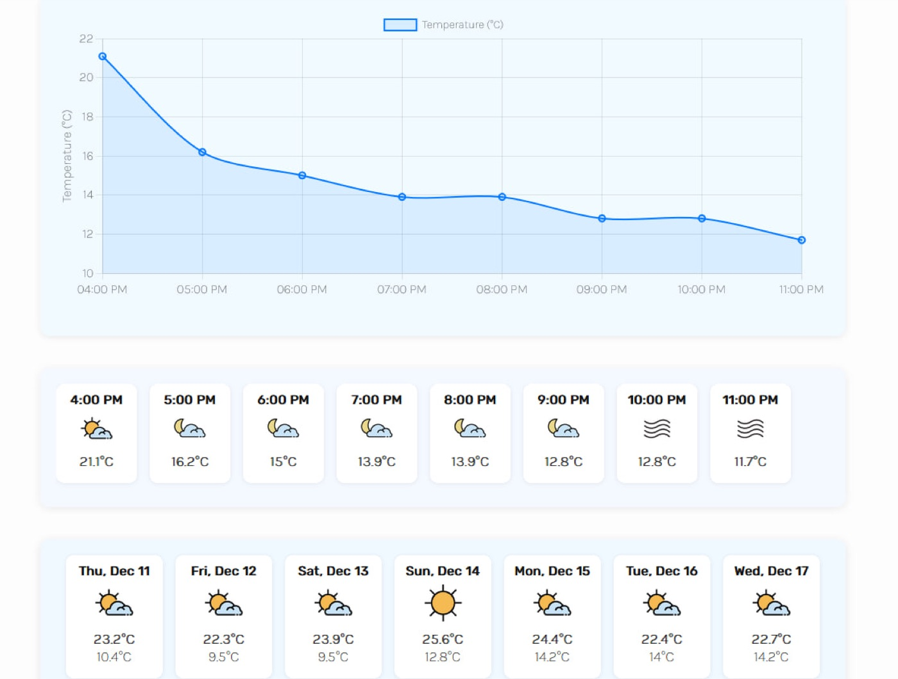

# Weather App

A weather forecast app that shows current conditions, a multi-day forecast and an hourly temperature chart for any location. Built as part of [The Odin Project](https://www.theodinproject.com/) JavaScript curriculum.

**▶ Live demo:** https://liza-uchaneva.github.io/WeatherApp_TheOdinProject-/



## Features

- Search any city or address
- Current temperature, "feels like", and daily min/max
- Daily forecast list and a horizontally scrolling hourly forecast with weather icons
- Hourly temperature chart rendered with **Chart.js**
- Handles empty input, HTTP errors and API errors

## Tech stack

- Vanilla **JavaScript** (ES modules, `async`/`await`, Fetch API)
- [Visual Crossing Weather API](https://www.visualcrossing.com/weather-api)
- **Chart.js**
- **Webpack**, ESLint, Prettier

## Running locally

1. Get a free API key from [Visual Crossing](https://www.visualcrossing.com/weather-api).
2. Create `src/key.js` (it is git-ignored):
   ```js
   export const key = "YOUR_API_KEY";
   ```
3. Install and run:
   ```bash
   npm install
   npm run dev
   ```

## Note

This is a static front-end app, so the API key ships in the client bundle. In a production app, requests would go through a small backend proxy to keep the key private.
